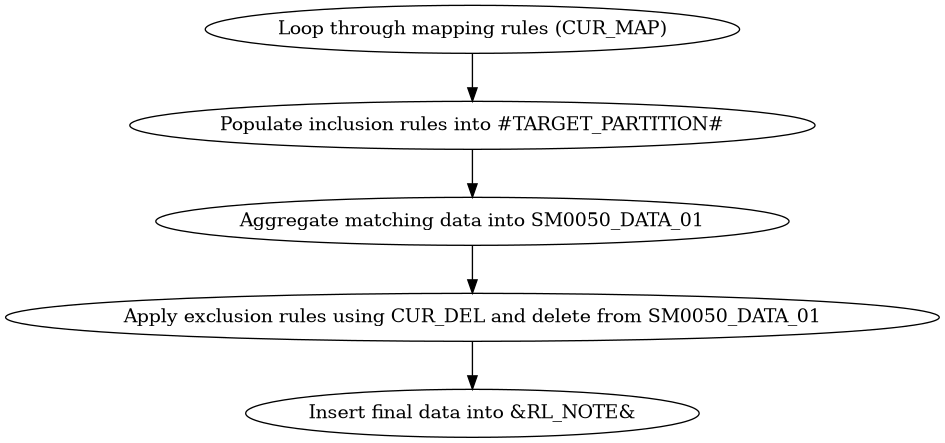

SM50 - explanation :

Here’s a high-level breakdown of what this script does:

---

### 🔁 **1. Loop Through Mapping Rules**
- A cursor (`CUR_MAP`) is declared to iterate over **distinct combinations of ACCOUNT, SCEN_TYPE, and BAL_TYPE** from a source mapping table.
- For each combination, the script:
  - Deletes previous data from the target note table (`&RL_NOTE&`) for `PROVENIENZA = 'SM0050'`.
  - Clears and repopulates a temporary table `#TARGET_PARTITION#` with **"INCLUDE" rules** from the mapping table.

---

### 📥 **2. Insert Matching Data into Temporary Table**
- The script builds a **comprehensive set of inclusion filters** (e.g., by scenario, entity, account, category, analysis, etc.) using multiple `UNION ALL` queries.
- It inserts the filtered data into `#TARGET_PARTITION#`.

---

### 📊 **3. Aggregate Matching Data**
- Data from the staging table (`&RL_MDA_STAGING&`) is filtered using the inclusion rules in `#TARGET_PARTITION#`.
- The filtered and aggregated data is inserted into `SM0050_DATA_01`.

---

### ❌ **4. Apply Exclusion Rules**
- A second cursor (`CUR_DEL`) is used to loop through **"EXCLUDE" rules** for the same account/scenario/balance type.
- For each exclusion rule:
  - A working table `SM0050_DELETE_01` is populated with all combinations of dimensions to be excluded.
  - These are then combined into `SM0050_DELETE_02` using `LEFT JOIN`s.
  - Matching records are deleted from `SM0050_DATA_01`.

---

### ✅ **5. Final Insertion into Target Note**
- The remaining data in `SM0050_DATA_01` is inserted into the final output table (`&RL_NOTE&`), with:
  - Aggregated amounts
  - Sign adjustments
  - Metadata like `TEXT_ORIGIN`, `PROVENIENZA`, `USERUPD`, etc.

---

### 🧩 **Key Concepts Used**
- **Dynamic filtering** using mapping rules
- **Hierarchical expansion** (e.g., using `GERARCHIA_FLAT` tables)
- **Temporary tables** for intermediate processing
- **Cursors** for row-by-row logic
- **Parameterized placeholders** (e.g., `&RL_MDA_MAP&`, `#USER#`) for Tagetik runtime substitution

---

### 🧠 Purpose
This script is likely part of a **financial consolidation or reporting process**, where:
- Data is **mapped** from operational systems to reporting structures.
- **Inclusion/exclusion logic** ensures only relevant data is processed.
- The final result is a **clean, rule-compliant dataset** for a specific reporting note (`SM0050`).

---

### Flowchart :

Here is the **visual flowchart** that illustrates the logic of the `SM50.sql` script in Tagetik using SAP HANA:

### 🔄 Flowchart Steps:
1. **Loop through mapping rules (`CUR_MAP`)**  
   Iterates over combinations of account, scenario type, and balance type.

2. **Populate inclusion rules into `#TARGET_PARTITION#`**  
   Gathers all relevant "INCLUDE" rules from the mapping table.

3. **Aggregate matching data into `SM0050_DATA_01`**  
   Filters and summarizes data from the staging table based on inclusion rules.

4. **Apply exclusion rules using `CUR_DEL`**  
   Deletes records from `SM0050_DATA_01` that match "EXCLUDE" rules.

5. **Insert final data into `&RL_NOTE&`**  
   Writes the cleaned and aggregated data into the final reporting note.

Would you like a **PDF version** of this flowchart or a **more detailed version** with sub-steps?